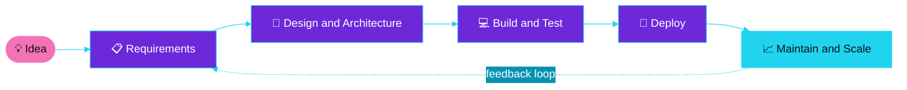
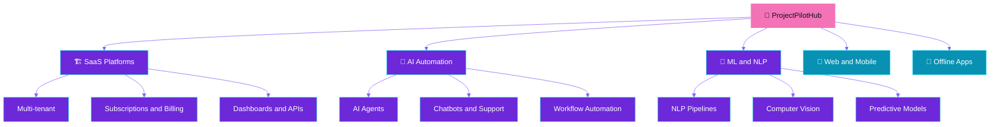

<div align="center">


<a href="https://projectpilothub.com/">
  
</a>

<br/>

[](https://projectpilothub.com/)
[](https://www.linkedin.com/in/project-pilothub-a27604419)
[](https://www.instagram.com/project_pilot_hub)
[](mailto:info@projectpilothub.com)
[](https://wa.me/923444586358)
[](https://calendly.com/REPLACE-WITH-YOUR-CALENDLY-LINK)


</div>


## 🚀 &nbsp;About ProjectPilotHub

<table>
<tr>
<td width="58%" valign="top">

**ProjectPilotHub** helps **students, startups and enterprises** build, deploy and scale intelligent, AI-powered products — with clarity, speed and reliable execution.

We turn ideas into **production-grade solutions**: from Final Year Projects to full-scale multi-tenant SaaS platforms and AI-driven automation systems.

> *Stop doing manual "robot work." We engineer systems that think.*

</td>
<td width="42%" valign="top">

```yaml
company  : ProjectPilotHub
founded  : 2016
hq       : Lahore, Punjab, Pakistan
focus    : Custom Software · SaaS · AI · ML/NLP
clients  : Students · Startups · Enterprises
industry : Healthcare · B2B SaaS · mHealth
status   : ✅ Accepting new projects
contact  : info@projectpilothub.com
```

</td>
</tr>
</table>


## 🧩 &nbsp;What We Build

<table>
<tr>
<td width="50%" valign="top">

### 🏗️ SaaS Development
Scalable platforms built from scratch — **multi-tenant architecture, subscriptions, dashboards and APIs**, designed around your business, not a template.

`Scalable Architecture` `Enterprise Security` `Cloud Ready`

</td>
<td width="50%" valign="top">

### 🤖 AI Automation
Workflow optimization, **AI agents, chatbots**, customer-support automation, email/communication automation and smart integrations.

`AI Agents` `Chatbots` `Workflow Automation`

</td>
</tr>
<tr>
<td width="50%" valign="top">

### 🧠 AI / ML &amp; NLP
Machine learning models, **NLP pipelines, computer vision** and data-driven AI for real-world problems.

`NLP` `Computer Vision` `ML Models`

</td>
<td width="50%" valign="top">

### 🎓 FYP Projects
Complete Final Year Project delivery — **research, development, documentation and presentation support**. Presentation-ready, end to end.

`Research` `Development` `Documentation`

</td>
</tr>
<tr>
<td width="50%" valign="top">

### 📱 Web &amp; Mobile Apps
Modern, responsive, user-focused apps — from **e-commerce experiences** to custom business tools, concept to launch.

`React` `Next.js` `Mobile-first`

</td>
<td width="50%" valign="top">

### 📴 Offline-First Solutions
Apps that **work without internet**: save locally, **sync to Firebase when back online**. Built for field work, medical records and insurance claims.

`Local DB` `Auto Sync` `Firebase`

</td>
</tr>
</table>

> 🗂️ **Business support services too:** data entry &amp; organization (paper, scanned, audio-to-data, Excel/Word) and accounting &amp; bookkeeping — confidential, accurate, on time.


## ⚙️ &nbsp;How We Work






## 🛠️ &nbsp;Our Tech Stack

<div align="center">

| Layer | Technologies |
| :---: | :--- |
| **🎨 Frontend** |  |
| **⚙️ Backend** |  |
| **🧠 AI / ML** |  |
| **🗄️ Data** |  |
| **☁️ Cloud & DevOps** |  |

</div>


## 🏆 &nbsp;Solutions We Deliver

| Domain | What we've built | Stack highlights |
| :--- | :--- | :--- |
| 🏥 **Healthcare** | Secure patient-record and clinic workflow systems, including offline-capable record management | `React` `Node.js` `Firebase` |
| 💼 **B2B SaaS** | Multi-tenant platforms with roles, subscriptions and analytics dashboards | `Next.js` `Node.js` `MongoDB` `AWS` |
| 📱 **Mobile Health** | Mobile-first health applications with AI-assisted features | `React` `Python` `TensorFlow` |
| 🛍️ **E-Commerce** | Smart product discovery, wishlist, checkout and responsive mobile-first storefront | `React` `Node.js` `MongoDB` |
| 🎓 **Academic AI** | NLP-based Final Year Projects that helped students achieve top marks | `Python` `NLP` `TensorFlow` |

> 🔗 *Detailed case studies and live demos: [projectpilothub.com](https://projectpilothub.com/)*


## 🎓 &nbsp;Internship Program

<table>
<tr>
<td width="62%" valign="top">

**Full Stack Developer Internship — Batch Aug 2026**

A 2-month, hands-on program that takes interns from beginner-friendly projects to shipping a **complete SaaS application** — the real company way.

`React.js` `Node.js` `Express.js` `MongoDB` `REST APIs` `Authentication` `RBAC` `Deployment`

</td>
<td width="38%" valign="top">

```text
Week 1-2 : Foundations + small builds
Week 3-5 : APIs, DB, auth, RBAC
Week 6-8 : Full SaaS app + deployment
```

</td>
</tr>
</table>


## 📈 &nbsp;GitHub Analytics

<div align="center">


</div>


## 🤝 &nbsp;Let's Build Something Intelligent

<div align="center">

| 📩 Email | 📞 Phone / WhatsApp | 📍 Location | 🌐 Website |
| :---: | :---: | :---: | :---: |
| [info@projectpilothub.com](mailto:info@projectpilothub.com) | [+92 344 4586358](https://wa.me/923444586358) | Lahore, Punjab, Pakistan | [projectpilothub.com](https://projectpilothub.com/) |

**1️⃣ Tell us your idea &nbsp;→&nbsp; 2️⃣ Get scope, timeline & estimate &nbsp;→&nbsp; 3️⃣ We build in milestones &nbsp;→&nbsp; 4️⃣ Launch & scale**

*"Your Project, Our Priority!"* 🚀


</div>
